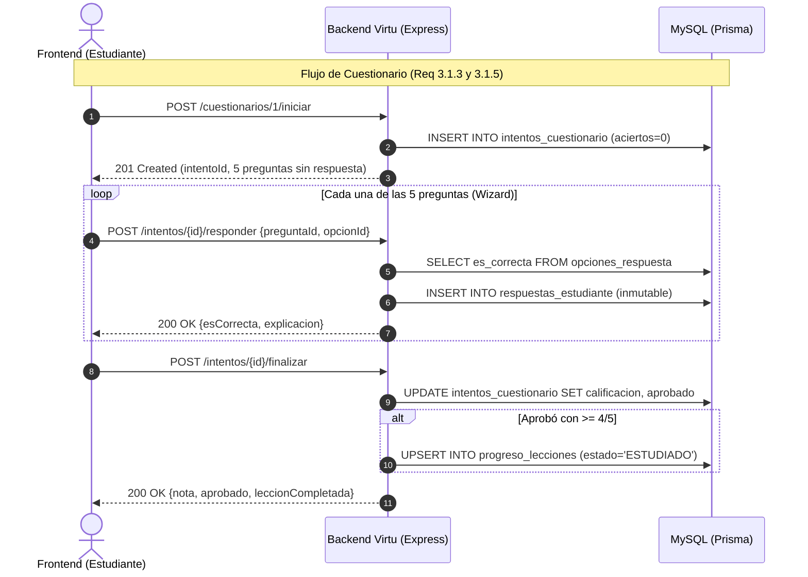

# 📚 Especificación de la API de Virtu
## Contrato de Endpoints e Interacción con Base de Datos para Desarrolladores Frontend

Este documento define la arquitectura de comunicación entre el frontend y el backend de **Virtu**, especificando cada endpoint, los datos de entrada/salida y las operaciones que ocurren en la base de datos MySQL (vía Prisma ORM).

---

## 📌 1. Convenciones Globales

### Base URL
* **Desarrollo:** `http://localhost:3000/api`
* **Producción:** `https://virtu-backend.onrender.com/api`

### Autenticación
Los endpoints protegidos requieren el encabezado HTTP:
```http
Authorization: Bearer <TOKEN_JWT>
```

### Formato de Respuestas

#### Respuesta Exitosa (200 OK / 201 Created):
```json
{
  "status": "success",
  "message": "Mensaje descriptivo (opcional)",
  "data": { ... }
}
```

#### Respuesta con Error (400 / 401 / 403 / 404 / 409 / 500):
```json
{
  "error": "TipoDeError",
  "message": "Descripción clara del motivo del fallo"
}
```

---

## 🔐 2. Módulo de Autenticación y Sesión (Req. 3.1.1)

### 2.1 Iniciar Sesión
* **Método:** `POST`
* **Ruta:** `/auth/login`
* **Acceso:** Público
* **Cuerpo de la Petición (JSON):**
  ```json
  {
    "username": "alumno1",
    "password": "Estudiante123!"
  }
  ```
* **Respuesta Exitosa (200 OK) - Estudiante:**
  ```json
  {
    "status": "success",
    "message": "Inicio de sesión exitoso",
    "data": {
      "token": "eyJhbGciOiJIUzI1NiIsInR5cCI6IkpXVCJ9...",
      "usuario": {
        "id": 2,
        "username": "alumno1",
        "nombreCompleto": "Sofía Valenzuela",
        "rol": "ESTUDIANTE",
        "colegio": { "id": 1, "nombre": "Colegio Virtu Central" },
        "curso": { "id": 1, "nombre": "4to Medio A" }
      }
    }
  }
  ```
* **Respuesta Exitosa (200 OK) - Docente:**
  ```json
  {
    "status": "success",
    "message": "Inicio de sesión exitoso",
    "data": {
      "token": "eyJhbGciOiJIUzI1NiIsInR5cCI6IkpXVCJ9...",
      "usuario": {
        "id": 1,
        "username": "profesor1",
        "nombreCompleto": "Prof. Carlos Mendoza",
        "rol": "DOCENTE",
        "colegio": { "id": 1, "nombre": "Colegio Virtu Central" },
        "cursos": [
          { "id": 1, "nombre": "4to Medio A" },
          { "id": 2, "nombre": "4to Medio B" }
        ]
      }
    }
  }
  ```
* **Interacción con BD:**
  * Consulta la tabla `usuarios` buscando por `username`.
  * Hace `JOIN` con `colegios`, `cursos` (si es estudiante) y `docentes_cursos` (si es docente).
  * Compara la contraseña usando `bcrypt`.

---

### 2.2 Obtener Perfil del Usuario Actual
* **Método:** `GET`
* **Ruta:** `/auth/me`
* **Acceso:** Requiere Token (Estudiante o Docente)
* **Respuesta Exitosa (200 OK):**
  Retorna el objeto `usuario` idéntico al del login para refrescar datos de sesión al recargar el navegador.
* **Interacción con BD:**
  * Lee el `id` dentro del JWT y busca el registro activo en `usuarios`.

---

## 📖 3. Módulo de Contenidos Académicos (Req. 3.1.2)

### 3.1 Listar Materias Disponibles
* **Método:** `GET`
* **Ruta:** `/contenidos`
* **Acceso:** Requiere Token
* **Respuesta Exitosa (200 OK):**
  ```json
  {
    "status": "success",
    "data": [
      {
        "id": 1,
        "nombre": "Biología",
        "slug": "biologia",
        "resumen": "Estudio de los seres vivos, genética y ecosistemas.",
        "estaHabilitado": true,
        "orden": 1
      },
      {
        "id": 2,
        "nombre": "Cálculo",
        "slug": "calculo",
        "resumen": "Estudio de funciones, derivadas e integrales.",
        "estaHabilitado": true,
        "orden": 2
      }
    ]
  }
  ```
* **Regla de Negocio:**
  * Los estudiantes solo pueden acceder a materias con `estaHabilitado = true`. Si intentan entrar a una deshabilitada, la API responde `403 Prohibido`.
* **Interacción con BD:**
  * Consulta tabla `contenidos` ordenada por `orden ASC`.

---

### 3.2 Obtener Detalle de Materia (Unidades y Lecciones)
* **Método:** `GET`
* **Ruta:** `/contenidos/:slug`
* **Acceso:** Requiere Token
* **Parámetros:** `slug` (ej. `biologia`, `historia`)
* **Respuesta Exitosa (200 OK):**
  ```json
  {
    "status": "success",
    "data": {
      "id": 6,
      "nombre": "Historia",
      "slug": "historia",
      "resumen": "Procesos históricos universales y revoluciones.",
      "unidades": [
        {
          "id": 1,
          "titulo": "Unidad 1: Las Grandes Revoluciones",
          "descripcion": "Transformaciones sociopolíticas del siglo XVIII y XIX",
          "orden": 1,
          "estado": "ESTUDIADO",
          "lecciones": [
            {
              "id": 1,
              "titulo": "La Revolución Francesa",
              "orden": 1,
              "tieneCuestionario": true,
              "estado": "ESTUDIADO"
            }
          ]
        }
      ]
    }
  }
  ```
* **Interacción con BD:**
  * Consulta jerárquica: `contenidos` $\rightarrow$ `unidades` $\rightarrow$ `lecciones`.
  * Cruza con `progreso_lecciones` para el `estudianteId` logueado para inyectar si cada lección está `ESTUDIADO` o `PENDIENTE`.

---

### 3.3 Obtener Detalle de una Lección
* **Método:** `GET`
* **Ruta:** `/lecciones/:id`
* **Acceso:** Requiere Token
* **Respuesta Exitosa (200 OK):**
  ```json
  {
    "status": "success",
    "data": {
      "id": 1,
      "titulo": "La Revolución Francesa",
      "definicion": "Movimiento político y social iniciado en 1789...",
      "ejemplo": "La Toma de la Bastilla el 14 de julio de 1789...",
      "tieneCuestionario": true,
      "cuestionarioId": 1,
      "estadoEstudiante": "ESTUDIADO"
    }
  }
  ```
* **Interacción con BD:**
  * Lee de `lecciones` y busca si existe registro asociado en `cuestionarios`.
  * Cruza con `progreso_lecciones` para obtener el estado actual del alumno.

---

## 📝 4. Motor de Cuestionarios y Evaluaciones (Req. 3.1.3)

Este motor está diseñado para un **Wizard secuencial pantalla a pantalla** (pregunta a pregunta).

### 4.1 Iniciar Intento de Cuestionario
* **Método:** `POST`
* **Ruta:** `/cuestionarios/:id/iniciar`
* **Acceso:** Solo Rol `ESTUDIANTE`
* **Respuesta Exitosa (201 Created):**
  ```json
  {
    "status": "success",
    "message": "Intento de cuestionario iniciado",
    "data": {
      "intentoId": 12,
      "numeroIntento": 2,
      "tiempoLimiteSegundos": 300,
      "totalPreguntas": 5,
      "preguntas": [
        {
          "id": 1,
          "orden": 1,
          "enunciado": "¿En qué año comenzó la Revolución Francesa?",
          "opciones": [
            { "id": 1, "texto": "1789" },
            { "id": 2, "texto": "1776" },
            { "id": 3, "texto": "1804" },
            { "id": 4, "texto": "1815" }
          ]
        }
      ]
    }
  }
  ```
* **Regla de Seguridad:** La API **NO** envía el campo `esCorrecta` al frontend para evitar trampas en el navegador.
* **Interacción con BD:**
  * Cuenta los intentos previos del alumno en `intentos_cuestionario` para calcular `numeroIntento = anteriores + 1`.
  * Inserta un nuevo registro en `intentos_cuestionario` con fecha actual.

---

### 4.2 Confirmar Respuesta de una Pregunta (Secuencial)
* **Método:** `POST`
* **Ruta:** `/intentos/:intentoId/responder`
* **Acceso:** Solo Rol `ESTUDIANTE`
* **Cuerpo de la Petición (JSON):**
  ```json
  {
    "preguntaId": 1,
    "opcionSeleccionadaId": 1
  }
  ```
* **Respuesta Exitosa (200 OK):**
  ```json
  {
    "status": "success",
    "data": {
      "preguntaId": 1,
      "esCorrecta": true,
      "explicacion": "La toma de la Bastilla ocurrió el 14 de julio de 1789.",
      "opcionCorrectaId": 1,
      "respuestasConfirmadas": 1,
      "totalPreguntas": 5
    }
  }
  ```
* **Reglas del Negocio:**
  * La respuesta es **inmutable**: si el estudiante intenta reenviar la misma pregunta, la API devuelve error `400 Respuesta ya confirmada`.
  * Si la respuesta fue incorrecta, `explicacion` contiene la solución pedagógica.
* **Interacción con BD:**
  * Verifica en `opciones_respuesta` si la opción elegida tiene `es_correcta = true`.
  * Inserta el registro en `respuestas_estudiante`.

---

### 4.3 Finalizar Cuestionario y Obtener Calificación
* **Método:** `POST`
* **Ruta:** `/intentos/:intentoId/finalizar`
* **Acceso:** Solo Rol `ESTUDIANTE`
* **Respuesta Exitosa (200 OK):**
  ```json
  {
    "status": "success",
    "message": "Cuestionario completado",
    "data": {
      "intentoId": 12,
      "aciertos": 4,
      "totalPreguntas": 5,
      "calificacion": 6.0,
      "aprobado": true,
      "leccionCompletada": true,
      "fechaEjecucion": "2026-11-06T12:30:00.000Z",
      "retroalimentacion": [
        {
          "preguntaId": 1,
          "enunciado": "¿En qué año comenzó la Revolución Francesa?",
          "opcionSeleccionadaId": 1,
          "opcionCorrectaId": 1,
          "acerto": true,
          "solucion": "La toma de la Bastilla ocurrió el 14 de julio de 1789."
        }
      ]
    }
  }
  ```
* **Reglas del Negocio (Req. 3.1.3 y 3.1.5):**
  * Si `aciertos >= 4`: Se considera **APROBADO** (`aprobado = true`).
  * Al aprobar, el sistema **marca automáticamente la lección como `ESTUDIADO`** en `progreso_lecciones`.
  * Si la unidad completa todas sus lecciones estudiadas, pasa a estado `ESTUDIADO`.
  * **La nota reemplaza a la anterior para el docente**: La API marca los intentos anteriores del alumno en este cuestionario con `es_nota_vigente = false` y este último con `es_nota_vigente = true`.
* **Interacción con BD:**
  * Cuenta las respuestas correctas en `respuestas_estudiante`.
  * Actualiza `intentos_cuestionario` con `aciertos`, `calificacion`, `aprobado` y `es_nota_vigente`.
  * Si aprobó, ejecuta un `UPSERT` en `progreso_lecciones` poniendo `estado = 'ESTUDIADO'`.

---

## 📈 5. Registro de Progreso del Estudiante (Req. 3.1.5)

### 5.1 Marcar Lección como "Estudiado" Manualmente
* **Método:** `POST`
* **Ruta:** `/lecciones/:id/marcar-estudiado`
* **Acceso:** Solo Rol `ESTUDIANTE`
* **Regla Estricta (Req. 3.1.5):**
  * **Solo se permite si la lección NO TIENE cuestionario.**
  * Si la lección tiene cuestionario, la API rechaza la petición con `400 Bad Request: "Esta lección posee cuestionario. Debe aprobarse con 4/5 para marcarse como estudiada"`.
* **Respuesta Exitosa (200 OK):**
  ```json
  {
    "status": "success",
    "message": "Lección marcada como estudiada exitosamente",
    "data": {
      "leccionId": 3,
      "estado": "ESTUDIADO",
      "unidadCompletada": false
    }
  }
  ```
* **Interacción con BD:**
  * Consulta si existe cuestionario vinculado a la lección.
  * Inserta o actualiza en `progreso_lecciones` con `estado = 'ESTUDIADO'` y `fecha_completado = NOW()`.
  * Verifica si todas las lecciones de la unidad quedaron estudiadas.

---

## 🔍 6. Glosarios Modulares por Materia (Req. 3.1.4 y 3.2)

Cada materia tiene su propia estructura de glosario y permite búsqueda de texto sin distinguir mayúsculas ni minúsculas.

### 6.1 Listar o Buscar en Glosario de una Materia
* **Método:** `GET`
* **Ruta:** `/glosarios/:materia`
* **Query Params Opcionales:** `?q=termino_a_buscar`
* **Acceso:** Requiere Token

#### Estructura de Respuesta según `:materia`:

#### A. `/glosarios/historia` (Req. 3.2.1)
```json
{
  "status": "success",
  "data": [
    {
      "id": 1,
      "tematica": "Revolución Francesa",
      "datoHistorico": "Toma de la Bastilla",
      "definicion": "Asalto a la fortaleza medieval de París.",
      "lineaTiempo": "Inicio de la Revolución",
      "esPersonaje": false,
      "fechaHistorica": "14 de Julio de 1789",
      "ordenCronologico": 1789
    }
  ]
}
```

#### B. `/glosarios/fisica` (Req. 3.2.2)
```json
{
  "status": "success",
  "data": [
    {
      "id": 1,
      "tematica": "Dinámica",
      "concepto": "Fuerza Centrípeta",
      "definicion": "Fuerza dirigida al centro de curvatura...",
      "linkVideo": "https://www.youtube.com/watch?v=..."
    }
  ]
}
```

#### C. `/glosarios/ingles` (Req. 3.2.3)
```json
{
  "status": "success",
  "data": [
    {
      "id": 1,
      "palabra": "Achieve",
      "definicion": "Successfully reach a desired goal...",
      "pronunciacion": "/əˈtʃiːv/",
      "tiempoVerbal": "Verb (Regular)",
      "linkAudio": "https://assets.virtu.edu/audio/achieve.mp3",
      "ejemplo": "Students work hard to achieve high scores."
    }
  ]
}
```

#### D. `/glosarios/biologia` (Req. 3.2.4)
```json
{
  "status": "success",
  "data": [
    {
      "id": 1,
      "tematica": "Genética",
      "concepto": "Genotipo",
      "definicion": "Conjunto de los genes de un individuo...",
      "esFlashcard": true
    }
  ]
}
```

#### E. `/glosarios/calculo` (Req. 3.2.5)
```json
{
  "status": "success",
  "data": [
    {
      "id": 1,
      "tematica": "Cálculo Diferencial",
      "titulo": "Definición formal de Derivada",
      "definicion": "Límite del cociente incremental...",
      "renderizacion": "f'(x) = \\lim_{h \\to 0} \\frac{f(x+h) - f(x)}{h}"
    }
  ]
}
```

#### F. `/glosarios/quimica` (Req. 3.2.6)
```json
{
  "status": "success",
  "data": [
    {
      "id": 1,
      "elementoQuimico": "Oxígeno",
      "nombre": "Oxígeno",
      "simbolo": "O",
      "numeroAtomico": 8,
      "clasificacion": "No metal",
      "formulaEjemplo": "H2O"
    }
  ]
}
```

* **Regla de Búsqueda:** Si se usa `?q=xyz` y no hay resultados, la API responde `200 OK` con un array vacío `data: []` y el mensaje `"No se encontraron coincidencias"`.
* **Interacción con BD:**
  * Realiza consultas con filtro `OR` y `contains` en los campos textuales de la tabla respectiva (`glosario_historia`, `glosario_fisica`, etc.).

---

### 6.2 Línea de Tiempo Secuencial de Historia (Req. 3.2.1)
* **Método:** `GET`
* **Ruta:** `/glosarios/historia/linea-tiempo/:id`
* **Acceso:** Requiere Token
* **Descripción:** Retorna el evento seleccionado junto con **los 2 acontecimientos anteriores y los 2 posteriores** ordenados por su fecha cronológica.
* **Respuesta Exitosa (200 OK):**
  ```json
  {
    "status": "success",
    "data": {
      "eventoActual": {
        "id": 5,
        "datoHistorico": "Ejecución de Luis XVI",
        "fechaHistorica": "21 de Enero de 1793",
        "ordenCronologico": 1793
      },
      "anteriores": [
        { "id": 1, "datoHistorico": "Toma de la Bastilla", "ordenCronologico": 1789 },
        { "id": 3, "datoHistorico": "Fuga de Varennes", "ordenCronologico": 1791 }
      ],
      "posteriores": [
        { "id": 7, "datoHistorico": "Inicio del Terror", "ordenCronologico": 1793 },
        { "id": 9, "datoHistorico": "Caída de Robespierre", "ordenCronologico": 1794 }
      ]
    }
  }
  ```
* **Interacción con BD:**
  * Lee el `ordenCronologico` del ID seleccionado.
  * Consulta:
    * `WHERE ordenCronologico < actual ORDER BY ordenCronologico DESC LIMIT 2` (anteriores).
    * `WHERE ordenCronologico > actual ORDER BY ordenCronologico ASC LIMIT 2` (posteriores).

---

## 👨‍🏫 7. Panel de Supervisión Docente (Req. 3.1.6)

Endpoints exclusivos para el rol **`DOCENTE`** (modo solo lectura).

### 7.1 Listar Estudiantes de un Curso con % de Avance
* **Método:** `GET`
* **Ruta:** `/docente/cursos/:cursoId/estudiantes`
* **Acceso:** Solo Rol `DOCENTE` (el docente debe estar asignado a dicho curso)
* **Respuesta Exitosa (200 OK):**
  ```json
  {
    "status": "success",
    "data": {
      "curso": { "id": 1, "nombre": "4to Medio A" },
      "totalUnidades": 12,
      "estudiantes": [
        {
          "estudianteId": 2,
          "nombreCompleto": "Sofía Valenzuela",
          "username": "alumno1",
          "unidadesEstudiadas": 6,
          "porcentajeAvance": 50.0,
          "promedioNotas": 6.2
        }
      ]
    }
  }
  ```
* **Interacción con BD:**
  * Valida en `docentes_cursos` que el profesor tenga permisos sobre `:cursoId`.
  * Consulta los estudiantes con `cursoId = :cursoId`.
  * Cuenta las unidades donde todas sus lecciones están en `progreso_lecciones` con `estado = 'ESTUDIADO'`.

---

### 7.2 Ver Aciertos y Desaciertos por Estudiante y Lección
* **Método:** `GET`
* **Ruta:** `/docente/estudiantes/:estudianteId/lecciones/:leccionId`
* **Acceso:** Solo Rol `DOCENTE`
* **Respuesta Exitosa (200 OK):**
  ```json
  {
    "status": "success",
    "data": {
      "estudiante": "Sofía Valenzuela",
      "leccion": "La Revolución Francesa",
      "notaVigente": 6.0,
      "aciertosTotales": 4,
      "desaciertosTotales": 1,
      "detallePreguntas": [
        {
          "pregunta": "¿En qué año comenzó la Revolución Francesa?",
          "acerto": true,
          "respuestaDada": "1789",
          "respuestaCorrecta": "1789"
        },
        {
          "pregunta": "¿Qué monarca gobernaba Francia?",
          "acerto": false,
          "respuestaDada": "Luis XIV",
          "respuestaCorrecta": "Luis XVI"
        }
      ]
    }
  }
  ```
* **Interacción con BD:**
  * Consulta el último intento con `es_nota_vigente = true` en `intentos_cuestionario`.
  * Lee de `respuestas_estudiante` los registros asociados, uniendo con `preguntas` y `opciones_respuesta`.

---

## 🔄 8. Diagrama de Interacción Base de Datos


